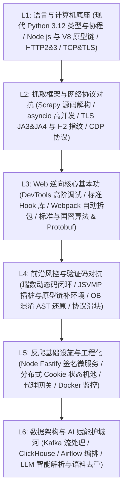

# 现代爬虫与数据工程知识体系及 16 周可持续进阶计划

> **定制状态（已确认锁定）**
> - **执行节奏**：工作日每晚 **30 分钟微任务**（低阻力阅读/重构/补文档）+ 周末 **半天 3~4 小时深度实战**（总计约 6~8 小时/周）
> - **高阶主攻护城河**：**路线 B（数据架构与 AI 赋能）** —— 大数据流批处理（Kafka / ClickHouse / Airflow）+ 大模型非结构化智能抽取与语料质量治理
> - **双轨环境红线**：工作环境保持全局 `Python 3.6.8` 零改动；本仓库强制通过 `uv` 锁定独立 `.venv` (`Python 3.12`) + `Node.js` 常驻微服务运行。

---

## 一、 现状深度诊断：历史技术资产与三大断层

基于历史仓库 [Airrrrrrrrrr/spider](https://github.com/Airrrrrrrrrr/spider) 与 [Airrrrrrrrrr/JsLearn](https://github.com/Airrrrrrrrrr/JsLearn) 源码盘点及当前工作栈分析：

### 1. 待唤醒的历史硬核资产
- **靶场通关经验**：Scrape Center（SSR / SPA 1~14 / CSS 偏移与精灵图 / 登录 / Wasm）、猿人学 Web 第一届（1~6、19 指纹、20 Wasm）、码上爬（01~17）、GlidedSky、SpiderBuf。
- **高难风控与补环境**：**瑞数 3/5/6 代**（药监局 NMPA、华能电商、CDE、网上房地产）、**小红书** `x-s` / `x-t`（`mnsv2` + `Proxy` 代理吐环境 + `Symbol` 伪造 `toString`）、**抖音** `a_bogus` 指纹环境。
- **模块化抠代码与协议验证码**：**Webpack 抠代码**（QQ 音乐、网易云音乐、`spa2`/`spa6`）、**极验 3 代**（`DrissionPage` + 纯协议逆向 `w` 参数 + `ddddocr`）、**顶象滑块**、东航接口。
- **AST 与 Wasm 初探**：Babel AST 基础还原（`path.evaluate()` 常量折叠）、JEB `wasmbc` 反编译 C 转写 JS、`Object.defineProperty` Cookie Hook、过无限 `debugger`。

### 2. 当前工作的隐性优势
- 掌握企业级采集流水线核心规范：**首次全量 + 后续增量双模式状态设计**、幂等去重、PDF 等多介质附件流转、MongoDB 原始层 -> 解析清洗层 -> MySQL/Kafka 业务层解耦、以及线上停更诊断排障能力。这正是向**路线 B（数据架构与 AI 数据工程）**跃迁的最佳跳板。

### 3. 三大核心断层（本仓库重点解决）
1. **脚本碎片化导致遗忘**：过往脚本依赖 `execjs`、写临时 JS 文件调 `subprocess`、手动复制硬编码 Cookie，缺乏常驻服务封装与标准复盘索引卡。
2. **Python 3.6.8 生态冻结**：工作环境无法使用现代 `asyncio`、`Pydantic v2`、`httpx`、`curl_cffi`、`Playwright` 及主流 AI/数据工程 SDK。
3. **定制框架黑盒化**：需拆解内部定制 Scrapy 源码，吃透底层引擎调度、中间件、连接池与分布式状态一致性原理。

---

## 二、 六层知识体系全景图（聚焦路线 B）

1. **L1 语言与网络底座**：Python 3.12（`Type Hints`、`Pydantic v2`、`asyncio` 事件循环与信号量背压控制）、JS/V8（原型链描述符对齐、`Proxy`/`Reflect`、`TypedArray` 位运算）、HTTP/2 二进制帧与 TLS 1.2/1.3 握手。
2. **L2 抓取框架与协议指纹**：`httpx` + `curl_cffi`（纯协议层模拟 Chrome JA3/JA4 与 Akamai HTTP/2 指纹）、CDP 原生控制、Scrapy 五大核心组件与 Twisted `Deferred` / `AsyncioSelectorReactor` 源码解构。
3. **L3 Web 逆向核心基本功**：无感日志断点（Logpoint）、Initiator 异步栈回溯、标准化 Snippets Hook 库、Webpack 4/5 模块按需自动导出、密码学魔数识别（MD5/AES/RSA/SM2~SM4）与 Protobuf 无 `.proto` 逆向。
4. **L4 高阶风控与反混淆**：Babel AST 全套解混淆（大数组移位解密、花指令内联、`while-switch` 控制流平坦化还原）、瑞数 5/6 代全自动会话闭环、JSVMP 双流派（纯净原型链沙箱补环境 vs 插桩日志纯算法还原）、Wasm 内存分析与 ONNX 验证码识别。
5. **L5 逆向工程化与基础设施**：Node.js `Fastify` 常驻高性能签名微服务 / 浏览器 WebSocket RPC、Redis 分布式账号/Cookie 冷却状态机池、智能代理健康评分网关、Docker Compose 编排与 Prometheus 监控。
6. **L6 数据架构与 AI 赋能（路线 B 专精）**：
   - **AI 驱动智能抽取**：DOM 降噪剪枝 + LLM 结构化 Schema 提取 / 自动生成 XPath 与清洗规则（将日常低难度资讯/公告站点的重复开发自动化）。
   - **现代数据工程栈**：Kafka 高吞吐消息队列解耦、ClickHouse 列式分析与海量日志/数据聚合、Elasticsearch 全文与向量检索、Airflow / DolphinScheduler DAG 调度编排、大规模文本近似去重（SimHash / MinHash LSH）与数据质量校验网关。

---

## 三、 16 周可持续实战路线清单

### 第一阶段（W1–W3）：破冰唤醒与工程底座重塑
- [ ] **W1（进行中 · Day 1 & Day 2 已打卡 ✅）：双轨环境隔离与跨语言微服务脚手架**
  - *Day 1（已完成）*：完成 `uv` 双轨隔离验证、迁移仓库至 `D:\spider`，吃透 `Pydantic v2` 与 `@dataclass` 选型（见 `docs/notes/w01_pydantic_and_dataclass.md`）。
  - *Day 2（已完成）*：吃透现代异步并发（`async with` / `TaskGroup` / `Semaphore`）与 `curl_cffi` 指纹封装（见 `docs/notes/w01_day2_async.md`），完成 `Scrape/spa6` 迁移契约侦察（见 `docs/tasks/w01_day2_plan.md`）。
  - *周末实战（3~4h）*：将旧仓库 `Scrape/spa6`（Webpack）迁移至 `sign_service/providers/spa6_webpack.js`，打通「Fastify 签名 -> `curl_cffi` 并发抓取 -> `CrawlRecord` 清洗去重落盘 JSONL」端到端闭环，并用独立小实验热身 `sandbox/env_proxy.js`。
- [ ] **W2：解构定制版 Scrapy 源码 + 原生异步中间件改造**
  - *平日微任务*：逐模块拆读公司定制版 Scrapy 基类、去重器与 Pipeline 源码，绘制内部数据流架构图。
  - *周末实战*：基于原生最新 Scrapy（启用 `AsyncioSelectorReactor`）编写集成 `curl_cffi` TLS 指纹伪造的 Downloader Middleware。
- [ ] **W3：标准化浏览器 Hook 武器库与 `env_proxy.js` 重构**
  - *平日微任务*：整理过无限 `debugger`、Cookie/Header/JSON Hook 标准油猴/Snippets 脚本。
  - *周末实战*：升级 `sign_service/sandbox/env_proxy.js`，实现支持原型链递归监控、属性噪音过滤与 `Function.prototype.toString` Symbol 保护的通用补环境底座。

### 第二阶段（W4–W8）：Web 逆向体系化深潜
- [ ] **W4–W5：Babel AST 反混淆 CLI 工具开发**（完成字符串大数组还原、花指令内联、`switch` 控制流平坦化还原）。
- [ ] **W6：瑞数 5/6 代（药监局等）全自动会话闭环重构**（打通首次 202/412 动态 meta 提取 -> 内存 VM 算二次后缀 `T` Cookie -> 自动续期请求，零人工介入）。
- [ ] **W7：JSVMP 双流派实战**（练习浏览器 Logpoint 插桩日志流分析入参变换 + 浏览器真机导出 `Object.getOwnPropertyDescriptors` 纯净原型骨架）。
- [ ] **W8：网络层指纹（JA3/JA4 & H2）、Protobuf 逆向与滑块轨迹工程化**。

### 第三阶段（W9–W12）：分布式网关与工作 AI 提效作品
- [ ] **W9–W10：Docker Compose 微型高可用采集网关**（编排 `Asyncio/Scrapy Workers` + `Redis Cookie 状态机池` + `Fastify 签名服务` + 异常熔断监控）。
- [ ] **W11–W12：低难度站点 AI 智能抽取 / 自动生成解析规则工具（简历核心亮点）**
  - 针对日常工作中高频出现的普通新闻、政务公告、电子报站点，开发本地辅助工具：输入样例 URL -> HTML 降噪剪枝 -> 自动推导列表/正文/附件提取规则并生成解析代码初稿 + Pydantic 质量校验报告。

### 第四阶段（W13–W16）：路线 B 纵深 —— 现代数据架构与语料工程
- [ ] **W13：Kafka 流式数据管道实战**（模拟高并发爬虫写入 Kafka Topic、Consumer Group 批量消费、死信队列 DLQ 与幂等写入）。
- [ ] **W14：ClickHouse 海量存储与大规模文本去重**（部署单机 ClickHouse 存储百万级结构化采集数据；实现基于 `SimHash` / `MinHash` 的近似重复文章检测，对接大模型高质量语料清洗标准）。
- [ ] **W15：工作流编排与数据质量网关**（使用 Airflow / Prefect 编排定时增量采集 -> 解析清洗 -> 完整性/空值率/括号对称等质量断言 -> 告警通知全链路 DAG）。
- [ ] **W16：端到端毕业级架构整合与模拟面试复盘**（将前 15 周成果整合为一套可一键演示的「高对抗采集 + 智能抽取 + 实时清洗数仓」个人代表作，提炼简历 STAR 法则亮点）。
